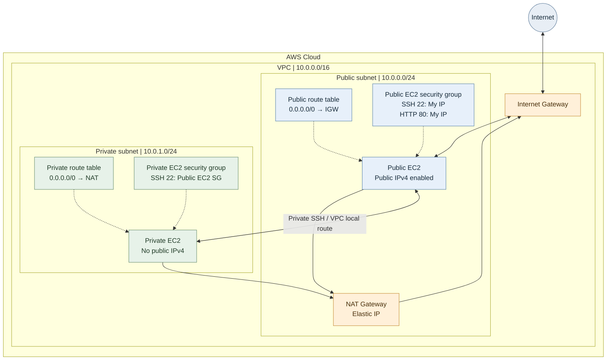

# AWS VPC & Networking

A hands-on AWS networking project focused on building a custom VPC, separating public and private workloads, and controlling how resources communicate with the internet.

The infrastructure was built using Amazon VPC, EC2, Internet Gateway, NAT Gateway, Elastic IPs, route tables and security groups.

## Project Overview

The objective was to build a network from scratch and understand how AWS handles traffic between public resources, private resources and the internet.

The VPC contains two subnets:

- **Public subnet:** Hosts an EC2 instance with a public IPv4 address. Internet traffic is routed through an Internet Gateway.
- **Private subnet:** Hosts an EC2 instance without a public IPv4 address. Outbound internet traffic is routed through a NAT Gateway.

## Architecture

The following diagram represents the network design and the intended traffic paths.



*The diagram shows the intended network paths. Security group rules control which traffic is actually permitted.*

## AWS Resources

| Resource | Configuration |
|---|---|
| VPC | `10.0.0.0/16` |
| Public subnet | `10.0.0.0/24` |
| Private subnet | `10.0.1.0/24` |
| Internet Gateway | Attached to VPC |
| Elastic IP | Allocated for NAT Gateway |
| NAT Gateway | Deployed in public subnet |
| Public EC2 | Public IPv4 enabled |
| Private EC2 | No public IPv4 |

## Implementation

### 1. VPC and subnet design

Created a custom VPC using the CIDR block `10.0.0.0/16`.

Divided the network into two separate subnets:

- `10.0.0.0/24` – Public subnet
- `10.0.1.0/24` – Private subnet

This provides network segmentation and allows different routing policies to be applied to each subnet.

### 2. Internet connectivity

Attached an Internet Gateway (IGW) to the VPC.

Created a NAT Gateway inside the public subnet and associated it with an Elastic IP.

The Internet Gateway provides internet connectivity for appropriately configured resources in the public subnet. The NAT Gateway allows instances in the private subnet to initiate outbound connections without requiring public IPv4 addresses.

### 3. Route tables

Created separate route tables and associated them with their respective subnets.

| Route table | Destination | Target |
|---|---|---|
| Public | `10.0.0.0/16` | Local |
| Public | `0.0.0.0/0` | Internet Gateway |
| Private | `10.0.0.0/16` | Local |
| Private | `0.0.0.0/0` | NAT Gateway |

The local route enables communication between resources within the VPC. The default routes determine how traffic destined outside the VPC is handled.

### 4. EC2 deployment

Deployed two EC2 instances to validate the network configuration.

**Public EC2**
- Deployed in the public subnet.
- Assigned a public IPv4 address.
- SSH access restricted to my public IP.
- Used to establish SSH connectivity to the private instance.

**Private EC2**
- Deployed in the private subnet.
- No public IPv4 address.
- Outbound internet access through the NAT Gateway.
- SSH access restricted to the public EC2 security group.

### 5. Security groups

Configured separate security groups for the two instances.

| Instance | Protocol | Port | Allowed source |
|---|---|---|---|
| Public EC2 | TCP | 22 | My public IP |
| Public EC2 | TCP | 80 | My public IP |
| Private EC2 | TCP | 22 | Public EC2 security group |

Security groups provide instance-level traffic control. The private instance does not accept SSH connections directly from the public internet.

## Validation

The following areas were checked during the project:

- Public EC2 placement and public IP assignment.
- SSH connectivity to the public instance.
- Private EC2 placement without a public IP.
- Private instance access from the public instance.
- Outbound internet connectivity through the NAT Gateway.
- Route table associations and default routes.
- Security group inbound rules.

See [Deployment Notes](docs/deployment-notes.md) for the validation checklist and test evidence.

## Key Takeaways

The project helped reinforce several important AWS networking concepts:

- A subnet is public or private based on its routing configuration.
- An Internet Gateway alone does not make an EC2 instance publicly reachable.
- Public IPv4 addressing, routing and security group rules must work together.
- NAT Gateway provides outbound connectivity for private instances.
- VPC-local routing allows communication between subnets without using an Internet Gateway.
- Security groups can reference other security groups instead of relying on fixed IP addresses.

## Limitations and Future Improvements

This is a foundational networking setup rather than a production-ready architecture.

Some improvements I would explore next:

- Deploy subnets across multiple Availability Zones.
- Introduce a second NAT Gateway for improved availability.
- Use AWS Systems Manager Session Manager instead of direct SSH administration.
- Enable VPC Flow Logs for network traffic analysis.
- Rebuild the infrastructure using Terraform.
- Add automated infrastructure validation.

## Cost Considerations

NAT Gateways incur hourly and data processing charges. EC2, storage and public IPv4 resources can also generate costs.

Resources should be removed after testing if they are no longer needed. See the deployment notes for the cleanup order.

## Repository Structure

```text
vpc-networking/
├── README.md
├── docs/
│   ├── architecture.md
│   └── deployment-notes.md
├── diagrams/
│   └── vpc-architecture.mmd
└── screenshots/
```

---

**Project:** AWS VPC & Networking  
**Focus:** Cloud Networking | AWS | Infrastructure | Security

Part of my ongoing hands-on DevOps and Cloud engineering learning journey.