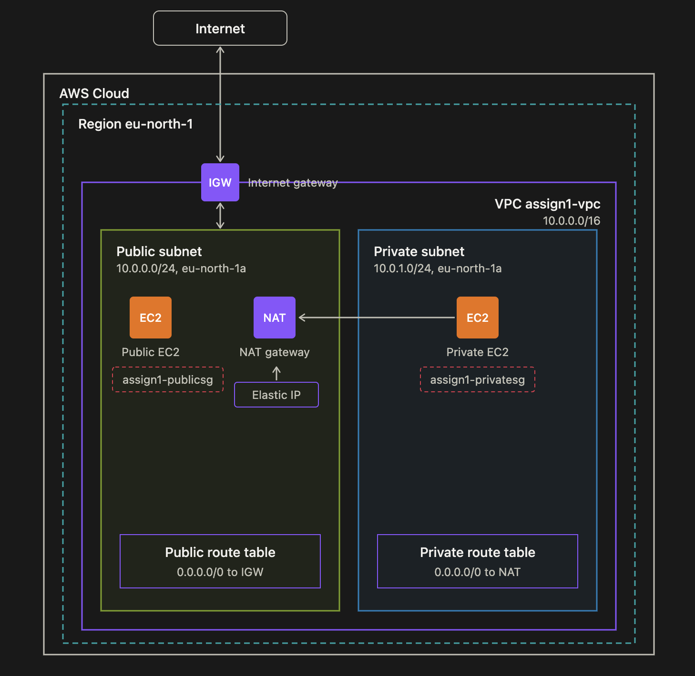

# AWS VPC & Networking

A custom AWS network built from scratch using Amazon VPC, public and private subnets, Internet Gateway, NAT Gateway, route tables and EC2 instances.

The goal of this project was to understand how AWS networking works in practice, particularly how resources communicate with each other and how internet access is controlled across different network segments.

## Architecture diagram

The infrastructure consists of a custom VPC with two subnets:

- **Public subnet:** Hosts an EC2 instance with a public IP address and direct internet connectivity through an Internet Gateway.
- **Private subnet:** Hosts an EC2 instance without a public IP address. Outbound internet traffic is routed through a NAT Gateway.

## AWS Resources

| Resource | Configuration |
|---|---|
| VPC | 10.0.0.0/16 |
| Public subnet | 10.0.0.0/24 |
| Private subnet | 10.0.1.0/24 |
| Internet Gateway | Attached to the VPC |
| Elastic IP | Allocated for NAT Gateway |
| NAT Gateway | Deployed in public subnet |
| Public EC2 | Public IP enabled |
| Private EC2 | No public IP |

## Network Configuration

### 1. VPC and Subnets

Created a custom VPC with the CIDR block `10.0.0.0/16`.

Divided the network into two subnets:

- Public subnet: `10.0.1.0/24`
- Private subnet: `10.0.2.0/24`

This separation provides control over which resources can be reached directly from the internet.

### 2. Internet Connectivity

**Internet Gateway (IGW)**

Attached an Internet Gateway to the VPC to enable internet connectivity for resources in the public subnet.

**NAT Gateway**

Deployed a NAT Gateway inside the public subnet and associated it with an Elastic IP.

The NAT Gateway allows instances in the private subnet to initiate outbound connections to the internet without exposing them through public IP addresses.

### 3. Route Tables

Configured separate route tables for each subnet.

| Route table | Destination | Target |
|---|---|---|
| Public | 10.0.0.0/16 | Local |
| Public | 0.0.0.0/0 | Internet Gateway |
| Private | 10.0.0.0/16 | Local |
| Private | 0.0.0.0/0 | NAT Gateway |

The public subnet uses the Internet Gateway for external traffic, while the private subnet routes external traffic through the NAT Gateway.

### 4. EC2 Deployment

Deployed two EC2 instances to test connectivity and network isolation.

**Public EC2**
- Launched in the public subnet.
- Assigned a public IPv4 address.
- Accessible through SSH from my permitted IP address.
- Used as an entry point for accessing the private instance.

**Private EC2**
- Launched in the private subnet.
- No public IPv4 address assigned.
- Outbound internet access through the NAT Gateway.
- SSH access restricted to the public EC2 instance's security group.

### 5. Security Groups

Configured security groups to control inbound traffic.

| Security group | Protocol | Port | Source |
|---|---|---|---|
| Public EC2 | SSH | 22 | My public IP |
| Public EC2 | HTTP | 80 | My public IP |
| Private EC2 | SSH | 22 | Public EC2 security group |

Outbound traffic was configured to allow the connectivity required by the instances.

## Testing and Validation

After deploying the infrastructure, I performed the following checks:

- Verified that the public EC2 instance received a public IP address.
- Connected to the public EC2 instance using SSH.
- Verified that the private EC2 instance had no public IP address.
- Tested SSH access from the public EC2 instance to the private EC2 instance.
- Tested outbound internet connectivity from the private instance.
- Verified that the private subnet used the NAT Gateway as its default route.
- Checked that the security groups restricted access as intended.

## Key Concepts Learned

Through this project, I gained practical experience with:

- AWS VPC architecture and CIDR addressing.
- Public and private subnet segmentation.
- Internet Gateway vs. NAT Gateway.
- Route tables and traffic routing.
- Elastic IP allocation.
- EC2 networking and public/private IP addressing.
- Security groups and network access control.
- SSH connectivity between instances.

## Lessons Learned

One important takeaway was understanding that launching an EC2 instance in a public subnet does not automatically make it accessible from the internet.

Internet connectivity depends on several components working together: public IP addressing, routing through an Internet Gateway and correctly configured security groups.

I also learned that a private instance can access external services through a NAT Gateway without needing a public IP address.

## Project Cleanup

AWS networking resources such as NAT Gateways and Elastic IPs can generate costs even when they are not actively being used.

After completing the project, the resources should be deleted to avoid unnecessary charges.

## Documentation

- [Architecture](docs/architecture.md)
- [Deployment Notes](docs/deployment-notes.md)

---

**Built as part of my hands-on AWS and DevOps learning journey.**